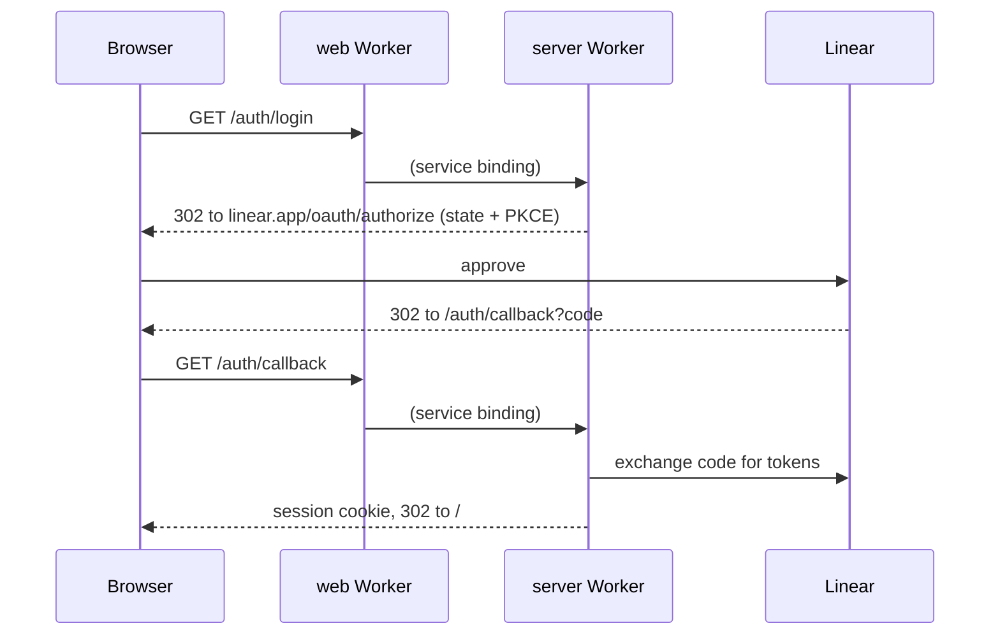

# Linear Weather

A team-load "weather report" for [Linear](https://linear.app), built on its GraphQL API.

Each developer's assigned issues are sorted into an **Eisenhower matrix** (Do / Schedule / Delegate / Drop). A PM can then see at a glance who is overloaded **now** and who is about to be.

## The idea

- **Quadrants from rules.** Default rules (configurable per team):
  - *Important*: Linear priority Medium or higher
  - *Urgent*: due within 14 days, or overdue
  - Issues with no due date count as not urgent

  A PM can still override any issue by hand.
- **Weather (now).** Each person's current urgent load compared with the team average: ☀️ ⛅ 🌧️ ⛈️
- **Forecast (next weeks).** Due dates show when each issue will turn urgent, so the app can project load week by week: `☀️ ☀️ 🌧️ ⛈️`. Undated work shows up as 🌫️ fog.
- **Rebalance.** The app suggests reassignments to fix today's storm or the one coming in week 3, and applies them in Linear with one click.

## Why GraphQL

This is a learning project. It consumes Linear's GraphQL API and exposes its own GraphQL server that extends Linear's types with derived fields (`quadrant`, `weather`, `forecast(weeks:)`). Along the way it covers DataLoader, mutations with typed errors, and subscriptions driven by Linear webhooks.

## Tech stack

Everything deploys to Cloudflare Workers.

| | |
|---|---|
| Workspace | [pnpm](https://pnpm.io) workspaces: `server/` and `web/` |
| Server | [Hono](https://hono.dev) Worker hosting [GraphQL Yoga](https://the-guild.dev/graphql/yoga-server) with a code-first [Pothos](https://pothos-graphql.dev) schema |
| Web | [Preact](https://preactjs.com) server-rendered by a Hono Worker, hydrated in the browser; built with [Vite](https://vite.dev) and the [Cloudflare Vite plugin](https://developers.cloudflare.com/workers/vite-plugin/) |
| Tests | [Vitest](https://vitest.dev); server tests run inside workerd via [`@cloudflare/vitest-plugin`](https://developers.cloudflare.com/workers/testing/vitest-integration/) |
| Lint/format | [Biome](https://biomejs.dev) |

## Development

Needs Node 24 (`.nvmrc`) and pnpm via Corepack (`corepack enable`).

```bash
pnpm install
cp server/.env.example server/.env   # then fill in the Linear OAuth app, see below
pnpm dev:web      # http://localhost:5173, runs the server Worker alongside
```

`pnpm dev:server` runs the server alone on http://localhost:8787 (GraphiQL at `/graphql`).

Checks (same as CI): `pnpm typecheck`, `pnpm lint`, `pnpm test`, `pnpm build`. `pnpm format` fixes formatting.

After changing a `wrangler.jsonc`, run `pnpm --filter server cf-typegen` to regenerate `worker-configuration.d.ts`.

## Signing in with Linear

People sign in with their own Linear account through OAuth, so the app sees exactly the workspaces and teams they can see in Linear.



- The browser only talks to the **web** Worker. It passes `/auth/*` and `/graphql` through to the **server** Worker over a [service binding](https://developers.cloudflare.com/workers/runtime-apis/bindings/service-bindings/), so the session cookie is first-party. (Separate `*.workers.dev` subdomains couldn't share a cookie.)
- Linear tokens stay on the server, in the `SESSIONS` KV namespace, keyed by a hash of the session cookie. Access tokens last about 24 hours and are refreshed automatically. Signing out revokes them.
- Scopes are `read,write`. `write` is for reassigning issues (#16), requested up front so nobody has to approve twice.

### Register the OAuth app

1. In Linear: **Settings → API → OAuth applications → New**. Any workspace you're an admin of will do. The app works for users in other workspaces too.
2. **Callback URLs**, one per line:
   - `http://localhost:5173/auth/callback` for local dev
   - `https://<your web Worker's domain>/auth/callback` for production
3. Copy the client ID and secret into `server/.env` as `LINEAR_CLIENT_ID` and `LINEAR_CLIENT_SECRET`. For production run `wrangler secret put LINEAR_CLIENT_ID` (and `LINEAR_CLIENT_SECRET`) in `server/`.
4. To let people outside your workspace sign in, turn on **Public** in the app's settings.

### Dev shortcut: personal API key

If you just want data without setting up OAuth, put a personal API key in `server/.env` as `LINEAR_API_KEY`. It's used only when nobody is signed in and only for requests to `localhost`, so it can't leak through a deployed Worker. Leave it empty to test the real login.

## Status

🌱 Scaffolding. Nothing useful to run yet.
# linear-weather
Eisenhower-matrix team load weather &amp; forecast for Linear, built with GraphQL
