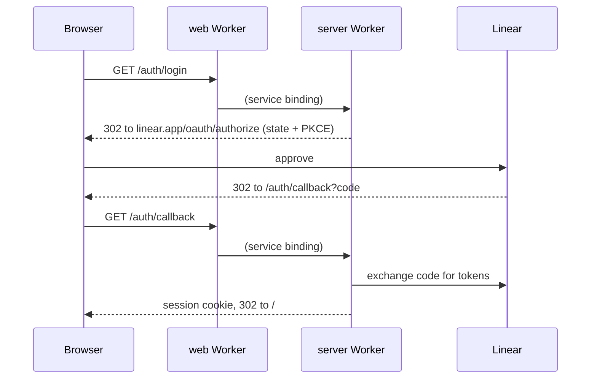

# Linear Weather

A team-load "weather report" for [Linear](https://linear.app), built on its GraphQL API.

Each developer's assigned issues are sorted into an **Eisenhower matrix** (Do / Schedule / Delegate / Drop). A PM can then see at a glance who is overloaded **now** and who is about to be.

## The idea

- **Quadrants from rules.** Default rules (configurable per team):
  - *Important*: Linear priority Medium or higher
  - *Urgent*: due within 14 days, or overdue
  - Issues with no due date count as not urgent

  A PM can still override any issue by hand.
- **Weather (now).** Each person's current urgent load compared with the team average: ☀️ ⛅ 🌧️ ⛈️
- **Forecast (next weeks).** Due dates show when each issue will turn urgent, so the app can project load week by week: `☀️ ☀️ 🌧️ ⛈️`. Undated work shows up as 🌫️ fog.
- **Rebalance.** The app suggests reassignments to fix today's storm or the one coming in week 3, and applies them in Linear with one click.

## Why GraphQL

This is a learning project. It consumes Linear's GraphQL API and exposes its own GraphQL server that extends Linear's types with derived fields (`quadrant`, `weather`, `forecast(weeks:)`). Along the way it covers DataLoader, mutations with typed errors, and subscriptions driven by Linear webhooks.

## Tech stack

Everything deploys to Cloudflare Workers.

| | |
|---|---|
| Workspace | [pnpm](https://pnpm.io) workspaces: `server/`, `web/` and `ui/` (shared Preact components) |
| Server | [Hono](https://hono.dev) Worker hosting [GraphQL Yoga](https://the-guild.dev/graphql/yoga-server) with a code-first [Pothos](https://pothos-graphql.dev) schema |
| Storage | [D1](https://developers.cloudflare.com/d1/) (Cloudflare's SQLite) for team rules and hand-placed issues, through [Drizzle ORM](https://orm.drizzle.team). Linear tokens live in KV |
| Web | [Preact](https://preactjs.com) server-rendered by a Hono Worker, hydrated in the browser; built with [Vite](https://vite.dev) and the [Cloudflare Vite plugin](https://developers.cloudflare.com/workers/vite-plugin/) |
| Styling | [StyleX](https://stylexjs.com), compiled at build time by `@stylexjs/unplugin`. Theme tokens (sky gradients, weather colours) live in `ui/src/tokens.stylex.ts` |
| Tests | [Vitest](https://vitest.dev); server tests run inside workerd via [`@cloudflare/vitest-plugin`](https://developers.cloudflare.com/workers/testing/vitest-integration/) |
| Lint/format | [Biome](https://biomejs.dev) |

## Development

Needs Node 24 (`.nvmrc`) and pnpm via Corepack (`corepack enable`).

```bash
pnpm install
cp server/.env.example server/.env   # then fill in the Linear OAuth app, see below
pnpm dev:web      # http://localhost:5173, runs the server Worker alongside
```

`pnpm dev:server` runs the server alone on http://localhost:8787 (GraphiQL at `/graphql`).

Both dev commands apply pending D1 migrations to the local database first.

Checks (same as CI): `pnpm typecheck`, `pnpm codegen:check`, `pnpm lint`, `pnpm test`, `pnpm build`. `pnpm format` fixes formatting.

After changing a `wrangler.jsonc`, run `pnpm --filter server cf-typegen` to regenerate `worker-configuration.d.ts`.

## Querying Linear

Queries to Linear live in `.graphql` files under `server/src/` (e.g. `server/src/linear/team-issues.graphql`). [GraphQL Code Generator](https://the-guild.dev/graphql/codegen) checks them against [Linear's schema](https://github.com/linear/linear/blob/master/packages/sdk/src/schema.graphql) and generates `server/src/linear/generated.ts`: one typed document per query (`OpenIssuesDocument`) plus its result and variable types. Code imports only the documents it uses, so the bundle carries just those queries, once each. We skip the client preset's `graphql()` tag because it bundles a lookup table of every query.

Linear also publishes a ready-made, typed SDK ([`@linear/sdk`](https://github.com/linear/linear/tree/master/packages/sdk)), generated from that same schema. We don't use it, because writing the queries and running codegen ourselves is part of what this project is for. It's also a fair trade on cost: our own queries fetch exactly the fields we need, and Linear's rate-limiting guide recommends custom queries over the SDK for fetching many issues.

- After adding or changing a query, run `pnpm --filter server codegen` and commit what it generates. `pnpm codegen:check` fails if the committed output is stale.
- The schema is fetched from Linear's SDK repo at a pinned commit (`LINEAR_SCHEMA_COMMIT` in `server/codegen.ts`). To pick up schema changes, bump the commit and rerun codegen.

Linear limits each user to 5,000 requests and 2,000,000 [complexity points](https://linear.app/developers/rate-limiting) an hour, and rejects any single query over 10,000 points. These limits shaped the open-issues query:

- **Only the fields the matrix needs** (the `IssueCard` fragment). Each field costs 0.1 points and each nested object costs 1, multiplied by the page size.
- **`nodes` instead of `edges { node cursor }`**, which saves an object per issue. `pageInfo.endCursor` is the only cursor needed.
- **Pages of 250**, Linear's maximum. A full page should cost about 1,300 points, which leaves plenty of room under the cap and keeps the request count low.
- **Filtering on the server**: only issues that aren't completed or canceled, in the teams asked for. One query covers several teams, and each issue carries its `team { id }` so they can be split up again.

The client reads Linear's rate-limit headers after each request and remembers what each query cost. Linear's budget refills continuously, so before sending a query the client waits until the remaining budget covers one more request at that cost. When Linear still answers `RATELIMITED`, it retries up to 3 times, waiting at least 0.25s, 0.5s, then 1s. If the budget would take more than 5s to refill, or the retries run out, it gives up with the time the budget resets.

## Our schema

The server's own schema (`server/src/schema.ts`, code-first with Pothos) mirrors the slice of Linear's `Issue`, `User` and `Team` the board needs, and extends them with fields derived by the pure rules engine in `server/src/domain/`:

```graphql
enum Quadrant { DO SCHEDULE DELEGATE DROP }
enum QuadrantSource { RULE OVERRIDE }

type Issue {          # id, identifier, title, url, dueDate, priority, estimate, state, assignee, plus:
  quadrant: Quadrant!
  quadrantSource: QuadrantSource!
  placementReason: String!   # "High priority, due in 3 days"
  becomesUrgentOn: Date      # today if already urgent, null if it never will be
}

type Matrix {         # each list most pressing first
  do: [Issue!]!  schedule: [Issue!]!  delegate: [Issue!]!  drop: [Issue!]!
  counts: QuadrantCounts!  points: QuadrantPoints!
}

type User { matrix(teamId: ID): Matrix! }   # defaults to the team it was reached through
type Team { rules: QuadrantRules!  people: [User!]!  unassigned: Matrix! }
type Query { today: Date!  viewer: User  teams: [Team]  team(id: ID): Team }

type Mutation {
  updateQuadrantRules(teamId: ID!, input: QuadrantRulesInput!): UpdateRulesResult!
  overrideQuadrant(issueId: ID!, quadrant: Quadrant!): OverrideResult!
  clearOverride(issueId: ID!): OverrideResult!
}
union UpdateRulesResult = UpdateRulesSuccess | InvalidRules | TeamNotFound | Unauthorized | LinearRateLimited
union OverrideResult = OverrideSuccess | IssueNotFound | Unauthorized | LinearRateLimited
interface Error { message: String! }   # every failure above implements it
```

### Mutations and their errors

Each mutation answers with a union: what it did, or one of the failures a client is expected to handle (bad rules, an id the viewer can't see, signed out, Linear's rate limit). They're ordinary types with fields of their own, like `InvalidRules.problems` (one per input field, for a settings form) or `LinearRateLimited.resetAt`, so clients see them in the schema and switch on `__typename`. Each implements `Error`, so `... on Error { message }` catches any a client doesn't single out. Top-level `errors` are left for the unexpected, like the database failing.

- **Checked against Linear first.** A team must be one the viewer can see, and so must an issue, so nobody changes rules or places issues in workspaces they aren't in.
- **The demo's changes stay in the visitor's browser.** Anyone can open `?demo=true`, so its mutations never reach D1: rules and overrides go in a compact `lw_demo` cookie (`server/src/db/demo-store.ts`, format in `demo-cookie.ts`), which every `?demo=true` request reads and any that changes something sets again. A cookie rather than localStorage, because the board renders on the server. The client still calls `/graphql?demo=true`, and sends mutations one at a time, since two in flight start from the same cookie and the last response wins. Clearing site data resets the demo.
- **Derived fields follow on their own.** A success hands back the team (and, for overrides, the issue), and everything on them is derived when read. After `updateQuadrantRules`, `team { people { matrix { counts } } }` in the same response is already sorted by the new rules, with no code written for it. Writes go through the request's `Placements`, so nothing later in the response reads what was cached before.

The web Worker loads a page with one query (`BOARD_QUERY` in `web/src/board.ts`), and a server test runs that exact query against the schema so the two can't drift apart. The board's mutations (`web/src/mutations.ts`) are tested the same way. Each asks for the team's board back through the same `TeamBoard` fragment the page loads with, so after a rules change or a move the browser redraws from the answer and never works out a quadrant itself. Within a request each team's members and issues are fetched from Linear once and shared by every resolver that needs them (`server/src/workspace.ts`). Two per-request [DataLoaders](https://github.com/graphql/dataloader) batch the lookups, one for team members and one for open issues, so every team resolved in the same tick shares one Linear query of each kind.

### N+1, measured

Resolvers don't fetch anything themselves. They ask the `Workspace` for a team's work: `Team.people` and `Team.unassigned` ask once each, and so does every person's `User.matrix`. The counts below come from the demo workspace (Avengers: 7 people plus unassigned issues; S.H.I.E.L.D. Ops: 4). Tests in `server/src/schema.test.ts` pin the "after" column.

| Query | Team lookups by resolvers | If each lookup fetched (2 requests) | Per-team cache (#8) | + DataLoader (#9) |
|---|---|---|---|---|
| `BOARD_QUERY`, one team | 9 | 20 | 4 | 4 |
| Every team's people and matrices, 2 teams | 15 | 31 | 5 | 3 |
| … with *T* teams | | ~2 × lookups + 1 | 1 + 2*T* | 2 + ⌈*T*/10⌉ |

The per-team cache removed the per-person N+1. That left one per team: each team cost a members query and an issues query of its own. DataLoader removes that too. Requests no longer grow with the number of people or teams, only with the number of issues (one more page per 250).

Measured against a real workspace (2 teams, 5 open issues) through Linear's `x-complexity` header:

| Linear query | Complexity |
|---|---|
| `Viewer` | 3 |
| `Teams` | 376 |
| `TeamsMembers`, 1 team / 2 teams | 327 / 653 |
| `OpenIssues`, 1 team / 2 teams | 8 / 8 |

- `TeamsMembers` grows by ~327 points a team, as [Linear's rules](https://linear.app/developers/rate-limiting) predict (250 members at 1.3 points each). Batches stop at 10 teams (~3,300 points), well under the 10,000 cap on one query. `OpenIssues` takes every team at once.
- `OpenIssues` cost the same for 1 issue and for 5. The ~1,300 a full page of 250 would cost by those rules is an estimate; no workspace we've tried has that many open issues.

Errors stay next to the field that failed: `teams` and `team` are nullable, so a rate-limited board still returns the `viewer`. Linear's rate limit comes back as `extensions: { code: "RATE_LIMITED", resetAt }` and a revoked token as `UNAUTHENTICATED`. Any other error is masked.

## Our own data

Linear holds the issues. What only this app knows lives in a D1 database (binding `DB`), defined in `server/src/db/tables.ts`:

- **`quadrant_rules`**: one row per team that changed its rules. Teams without a row use the defaults above, so a new team needs no setup.
- **`quadrant_override`**: issues a PM placed by hand, keyed by Linear's issue id, so an override follows the issue if it moves teams. An overridden issue reports `quadrantSource: OVERRIDE`, and its `placementReason` still says where the rules would put it. `becomesUrgentOn` keeps following the due date.

CHECK constraints keep values the board can't use out of the database, including non-integer rules that GraphQL's `Int` couldn't send.

Within a request, rules and overrides are read through two DataLoaders (`server/src/placements.ts`), so every team and person resolved in the same tick shares one query for rules and one for overrides. The ids go in as a single JSON parameter (`IN (SELECT value FROM json_each(?))`), because D1 binds at most 100 parameters per statement and a team can have thousands of open issues. If D1 fails, the board still loads, using the default rules and no hand placements, and the error is logged.

### Migrations

[Drizzle Kit](https://orm.drizzle.team/docs/kit-overview) writes SQL migrations from the tables, and Wrangler applies them with [D1's own migrations](https://developers.cloudflare.com/d1/reference/migrations/), which record what has run in a `d1_migrations` table.

- After changing `tables.ts`, run `pnpm --filter server db:generate` and commit the new file in `server/migrations/`.
- Local dev applies them for you. To apply them by hand, run `pnpm --filter server db:migrate:local`.
- Tests apply every migration to an empty database in workerd (`server/test/apply-migrations.ts`) and empty the tables after each test.
- In production, `pnpm --filter server deploy` (`server/scripts/deploy.sh`, the server's Workers Builds deploy command) applies migrations, then deploys. On the very first deploy Wrangler creates the database while deploying, so the script migrates right after instead. A migration runs while the previous code is still live, so it should add rather than rename or drop.
- [Worker Previews](https://developers.cloudflare.com/workers/previews/) of other branches use a shared staging database, `linear-weather-preview`, and their own session store (the `previews` block in `server/wrangler.jsonc`). `pnpm --filter server preview` (`server/scripts/preview.sh`, the server's Workers Builds preview command) migrates that database, then deploys the Preview.

### Previews

Every branch gets a Preview of each Worker, with its URL posted on the pull request. Previews don't inherit production settings, so each `wrangler.jsonc` lists its bindings again under `previews`, and secrets are set with `wrangler preview base-config secret put <NAME>`.

- **Try changes in the demo.** Linear's OAuth app only redirects back to the production URL, so signing in doesn't work on a Preview. Add `?demo=true`.
- **A web Preview talks to the production server.** Service bindings from a Preview reach the bound Worker's production deployment. To try a branch's server changes, use the server Preview's own URL: GraphiQL at `/graphql?demo=true`.

## Signing in with Linear

People sign in with their own Linear account through OAuth, so the app sees exactly the workspaces and teams they can see in Linear.



- The browser only talks to the **web** Worker. It passes `/auth/*` and `/graphql` through to the **server** Worker over a [service binding](https://developers.cloudflare.com/workers/runtime-apis/bindings/service-bindings/), so the session cookie is first-party. (Separate `*.workers.dev` subdomains couldn't share a cookie.)
- Linear tokens stay on the server, in the `SESSIONS` KV namespace, keyed by a hash of the session cookie. Access tokens last about 24 hours and are refreshed automatically. Signing out revokes them.
- Scopes are `read,write`. `write` is for reassigning issues (#16), requested up front so nobody has to approve twice.

### Register the OAuth app

1. In Linear: **Settings → API → OAuth applications → New**. Any workspace you're an admin of will do. The app works for users in other workspaces too.
2. **Callback URLs**, one per line:
   - `http://localhost:5173/auth/callback` for local dev
   - `https://<your web Worker's domain>/auth/callback` for production
3. Copy the client ID and secret into `server/.env` as `LINEAR_CLIENT_ID` and `LINEAR_CLIENT_SECRET`. For production run `wrangler secret put LINEAR_CLIENT_ID` (and `LINEAR_CLIENT_SECRET`) in `server/`.
4. To let people outside your workspace sign in, turn on **Public** in the app's settings.

### Dev shortcut: personal API key

If you just want data without setting up OAuth, put a personal API key in `server/.env` as `LINEAR_API_KEY`. It's used only when nobody is signed in and only for requests to `localhost`, so it can't leak through a deployed Worker. Leave it empty to test the real login.

### The demo workspace

No Linear account? Open `/?demo=true` to see the board as Nick Fury, PM of a mocked Avengers team. The web Worker passes the flag on to `/graphql?demo=true`, which answers from `server/src/linear/demo.ts` instead of Linear, whoever is signed in. The demo answers the same typed queries as Linear (through the `LinearSource` interface), with due dates counted from today, so tests can use it too: `new DemoLinear({ today: "2026-10-18" })`.

## Status

🌦️ Board: pick a team and see each person's issues sorted into Do / Schedule / Delegate / Drop by its team's rules or by hand, served by our GraphQL schema. **Sorting rules** edits the team's rules; each issue's menu moves it to another quadrant or hands it back to the rules, and cards placed by hand say so. Both work in the demo too.
# linear-weather
Eisenhower-matrix team load weather &amp; forecast for Linear, built with GraphQL
