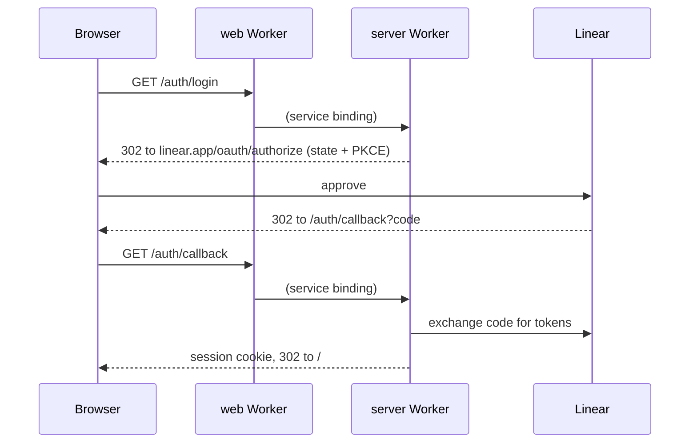

# Linear Weather

A team-load "weather report" for [Linear](https://linear.app), built on its GraphQL API.

Each developer's assigned issues are sorted into an **Eisenhower matrix** (Do / Schedule / Delegate / Drop). A PM can then see at a glance who is overloaded **now** and who is about to be.

## The idea

- **Quadrants from rules.** Default rules (configurable per team):
  - *Important*: Linear priority Medium or higher
  - *Urgent*: due within 14 days, or overdue
  - Issues with no due date count as not urgent

  A PM can still override any issue by hand.
- **Weather (now).** Each person's current urgent load compared with the team average: ☀️ ⛅ 🌧️ ⛈️
- **Forecast (next weeks).** Due dates show when each issue will turn urgent, so the app can project load week by week: `☀️ ☀️ 🌧️ ⛈️`. Undated work shows up as 🌫️ fog.
- **Rebalance.** The app suggests reassignments to fix today's storm or the one coming in week 3, and applies them in Linear with one click.

## Why GraphQL

This is a learning project. It consumes Linear's GraphQL API and exposes its own GraphQL server that extends Linear's types with derived fields (`quadrant`, `weather`, `forecast(weeks:)`). Along the way it covers DataLoader, mutations with typed errors, and subscriptions driven by Linear webhooks.

## Tech stack

Everything deploys to Cloudflare Workers.

| | |
|---|---|
| Workspace | [pnpm](https://pnpm.io) workspaces: `server/`, `web/` and `ui/` (shared Preact components) |
| Server | [Hono](https://hono.dev) Worker hosting [GraphQL Yoga](https://the-guild.dev/graphql/yoga-server) with a code-first [Pothos](https://pothos-graphql.dev) schema |
| Web | [Preact](https://preactjs.com) server-rendered by a Hono Worker, hydrated in the browser; built with [Vite](https://vite.dev) and the [Cloudflare Vite plugin](https://developers.cloudflare.com/workers/vite-plugin/) |
| Styling | [StyleX](https://stylexjs.com), compiled at build time by `@stylexjs/unplugin`. Theme tokens (sky gradients, weather colours) live in `ui/src/tokens.stylex.ts` |
| Tests | [Vitest](https://vitest.dev); server tests run inside workerd via [`@cloudflare/vitest-plugin`](https://developers.cloudflare.com/workers/testing/vitest-integration/) |
| Lint/format | [Biome](https://biomejs.dev) |

## Development

Needs Node 24 (`.nvmrc`) and pnpm via Corepack (`corepack enable`).

```bash
pnpm install
cp server/.env.example server/.env   # then fill in the Linear OAuth app, see below
pnpm dev:web      # http://localhost:5173, runs the server Worker alongside
```

`pnpm dev:server` runs the server alone on http://localhost:8787 (GraphiQL at `/graphql`).

Checks (same as CI): `pnpm typecheck`, `pnpm codegen:check`, `pnpm lint`, `pnpm test`, `pnpm build`. `pnpm format` fixes formatting.

After changing a `wrangler.jsonc`, run `pnpm --filter server cf-typegen` to regenerate `worker-configuration.d.ts`.

## Querying Linear

Queries to Linear live in `.graphql` files under `server/src/` (e.g. `server/src/linear/team-issues.graphql`). [GraphQL Code Generator](https://the-guild.dev/graphql/codegen) checks them against [Linear's schema](https://github.com/linear/linear/blob/master/packages/sdk/src/schema.graphql) and generates `server/src/linear/generated.ts`: one typed document per query (`TeamOpenIssuesDocument`) plus its result and variable types. Code imports only the documents it uses, so the bundle carries just those queries, once each. We skip the client preset's `graphql()` tag because it bundles a lookup table of every query.

Linear also publishes a ready-made, typed SDK ([`@linear/sdk`](https://github.com/linear/linear/tree/master/packages/sdk)), generated from that same schema. We don't use it, because writing the queries and running codegen ourselves is part of what this project is for. It's also a fair trade on cost: our own queries fetch exactly the fields we need, and Linear's rate-limiting guide recommends custom queries over the SDK for fetching many issues.

- After adding or changing a query, run `pnpm --filter server codegen` and commit what it generates. `pnpm codegen:check` fails if the committed output is stale.
- The schema is fetched from Linear's SDK repo at a pinned commit (`LINEAR_SCHEMA_COMMIT` in `server/codegen.ts`). To pick up schema changes, bump the commit and rerun codegen.

Linear limits each user to 5,000 requests and 2,000,000 [complexity points](https://linear.app/developers/rate-limiting) an hour, and rejects any single query over 10,000 points. These limits shaped the team-issues query:

- **Only the fields the matrix needs** (the `IssueCard` fragment). Each field costs 0.1 points and each nested object costs 1, multiplied by the page size.
- **`nodes` instead of `edges { node cursor }`**, which saves an object per issue. `pageInfo.endCursor` is the only cursor needed.
- **Pages of 250**, Linear's maximum. A page costs about 1,000 points, which leaves plenty of room under the cap and keeps the request count low.
- **Filtering on the server**: only the team's issues that aren't completed or canceled.

The client reads Linear's rate-limit headers after each request and remembers what each query cost. Linear's budget refills continuously, so before sending a query the client waits until the remaining budget covers one more request at that cost. When Linear still answers `RATELIMITED`, it retries up to 3 times, waiting at least 0.25s, 0.5s, then 1s. If the budget would take more than 5s to refill, or the retries run out, it gives up with the time the budget resets.

## Our schema

The server's own schema (`server/src/schema.ts`, code-first with Pothos) mirrors the slice of Linear's `Issue`, `User` and `Team` the board needs, and extends them with fields derived by the pure rules engine in `server/src/domain/`:

```graphql
enum Quadrant { DO SCHEDULE DELEGATE DROP }
enum QuadrantSource { RULE OVERRIDE }   # OVERRIDE arrives with stored overrides (#10)

type Issue {          # id, identifier, title, url, dueDate, priority, estimate, state, assignee, plus:
  quadrant: Quadrant!
  quadrantSource: QuadrantSource!
  placementReason: String!   # "High priority, due in 3 days"
  becomesUrgentOn: Date      # today if already urgent, null if it never will be
}

type Matrix {         # each list most pressing first
  do: [Issue!]!  schedule: [Issue!]!  delegate: [Issue!]!  drop: [Issue!]!
  counts: QuadrantCounts!  points: QuadrantPoints!
}

type User { matrix(teamId: ID): Matrix! }   # defaults to the team it was reached through
type Team { rules: QuadrantRules!  people: [User!]!  unassigned: Matrix! }
type Query { today: Date!  viewer: User  teams: [Team]  team(id: ID): Team }
```

The web Worker loads a page with one query (`BOARD_QUERY` in `web/src/board.ts`), and a server test runs that exact query against the schema so the two can't drift apart. Within a request each team's members and issues are fetched from Linear once and shared by every resolver that needs them (`server/src/workspace.ts`). Batching across fields is #9.

Errors stay next to the field that failed: `teams` and `team` are nullable, so a rate-limited board still returns the `viewer`. Linear's rate limit comes back as `extensions: { code: "RATE_LIMITED", resetAt }` and a revoked token as `UNAUTHENTICATED`. Any other error is masked.

## Signing in with Linear

People sign in with their own Linear account through OAuth, so the app sees exactly the workspaces and teams they can see in Linear.



- The browser only talks to the **web** Worker. It passes `/auth/*` and `/graphql` through to the **server** Worker over a [service binding](https://developers.cloudflare.com/workers/runtime-apis/bindings/service-bindings/), so the session cookie is first-party. (Separate `*.workers.dev` subdomains couldn't share a cookie.)
- Linear tokens stay on the server, in the `SESSIONS` KV namespace, keyed by a hash of the session cookie. Access tokens last about 24 hours and are refreshed automatically. Signing out revokes them.
- Scopes are `read,write`. `write` is for reassigning issues (#16), requested up front so nobody has to approve twice.

### Register the OAuth app

1. In Linear: **Settings → API → OAuth applications → New**. Any workspace you're an admin of will do. The app works for users in other workspaces too.
2. **Callback URLs**, one per line:
   - `http://localhost:5173/auth/callback` for local dev
   - `https://<your web Worker's domain>/auth/callback` for production
3. Copy the client ID and secret into `server/.env` as `LINEAR_CLIENT_ID` and `LINEAR_CLIENT_SECRET`. For production run `wrangler secret put LINEAR_CLIENT_ID` (and `LINEAR_CLIENT_SECRET`) in `server/`.
4. To let people outside your workspace sign in, turn on **Public** in the app's settings.

### Dev shortcut: personal API key

If you just want data without setting up OAuth, put a personal API key in `server/.env` as `LINEAR_API_KEY`. It's used only when nobody is signed in and only for requests to `localhost`, so it can't leak through a deployed Worker. Leave it empty to test the real login.

### The demo workspace

No Linear account? Open `/?demo=true` to see the board as Nick Fury, PM of a mocked Avengers team. The web Worker passes the flag on to `/graphql?demo=true`, which answers from `server/src/linear/demo.ts` instead of Linear, whoever is signed in. The demo answers the same typed queries as Linear (through the `LinearSource` interface), with due dates counted from today, so tests can use it too: `new DemoLinear({ today: "2026-10-18" })`.

## Status

🌦️ Read-only board: pick a team and see each person's issues sorted into Do / Schedule / Delegate / Drop with the default rules, served by our GraphQL schema.
# linear-weather
Eisenhower-matrix team load weather &amp; forecast for Linear, built with GraphQL
